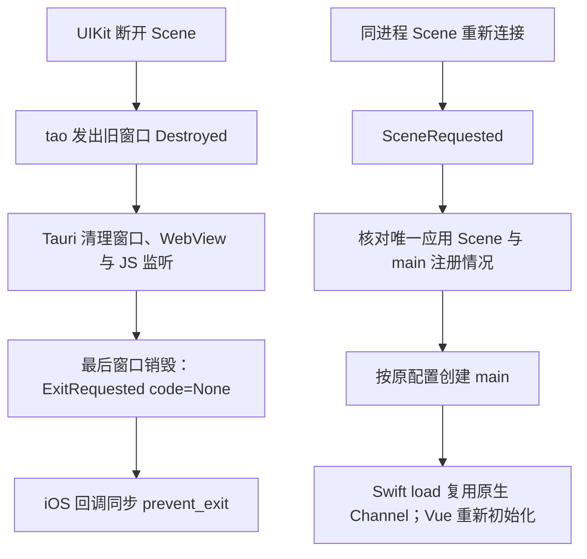

# Phase 2：R2 与 R3 技术方案

> 2026-10-09，代码基线 `70138f20`。用户授权研究具体技术方案，使用 3 位子代理交叉审查。本文是推荐实施方案，尚未修改应用、依赖或测试，未执行 Apple 构建。09 的能力审议由用户继续编辑，本轮不改变功能范围。

> 后续状态：R2/R3 已在 `e60ed51a` 实现，API 细化与施工证据见 [12](./12-R2与R3实施与验证.md)，独立提交复审见 [13](./13-R2与R3提交复审.md)。以下保留研究时的方案，不替代当前生产代码。

## 1. 裁决与交付范围

R2、R3 都属于阶段二已经接入的基础链路，应在本阶段处理。按现有生产调用链，推荐如下：

| 问题 | 推荐处理 | 依据 |
|---|---|---|
| R2：最后窗口销毁后误入退出路径；同进程 Scene 重连没有主窗口 | 应用层明确 iOS 单窗口的进程存续与重建策略，复用 Tauri 注册表和原 `main` 配置 | 现有公开 API 能阻止隐式退出，并在单 Scene 条件下创建窗口；不必先恢复 vendor 补丁 |
| R3：订阅超时被当作失败，最终结果无人消费 | 接收 helper 只负责接收安全；能力查询保留 5 秒等待，独立订阅任务等待真实完成 | 订阅在 Rust READY 后独立运行，不阻塞 bootstrap 返回 |
| R2/R3 交集：旧 WebView 读走真实故障，新 WebView 无法再获知 | 现有 Rust 故障集合保留真实 `Events` 注册失败；每个 WebView 接受一次提示 | 进程故障和界面告知的生命周期不同，有实际消费者需要分别保留 |

本方案不增加订阅重试、成功撤警协议、通用健康监控或第二份窗口存活表。方案需要增加的 UI 告知记忆有明确用途，不能为了保持“零新增状态”而丢掉重建后仍存在的故障。

## 2. R2：iOS 单主窗口恢复

### 2.1 事件与职责

当前 `lib.rs` 忽略 iOS RunEvent。建议新增仅在 iOS 编译的 `vcp_modules/infra/ios_window.rs`，承接窗口生命周期策略；在 `infra/mod.rs` 按目标声明，`lib.rs` 只转交事件和记录返回错误。它属于 Tauri 窗口装配边界，不接管 Chat/Sync，也不进入 Swift 业务插件。



这里描述满足条件时的源码路径。普通切后台不等于 Scene 断开；系统终止进程后的冷启动走原启动路径。

### 2.2 最后窗口销毁与进程退出分开处理

锁定 runtime-wry 的 `ExitRequested` 有两种来源：最后窗口销毁产生 `code=None`；主动 `RequestExit` 产生 `Some(code)`。iOS 对前者在当前事件回调中同步调用 `api.prevent_exit()`，不保存该 API、不转交异步任务。

`None` 只说明隐式退出来源，不能识别具体 Scene 断开原因；方案依据是 iOS 最后窗口消失不应由应用自行结束进程。`Some(code)` 不在本次拦截范围，当前 iOS `restart_or_exit_app` 本身拒绝执行。UIKit 真正终止应用时，tao 仍会进入其 `terminated()` 路径。

这能避开当前 tao Exit 分支的状态缺失，但不意味着修复了框架所有退出情形。实现中不新增“刚刚断连”标志，也不重复初始化 Rust 领域状态。

### 2.3 SceneRequested 的处理步骤

在当前 UIKit 主线程回调同步处理，Scene 对象不送入 Tokio：

1. 用 `MainThreadMarker::new()`确认线程；请求对象必须是 `UIWindowScene`，session role 为 `UIWindowSceneSessionRoleApplication`。
2. 读取 `UIApplication.connectedScenes`，要求其中总共只有当前请求的这一个 Scene，并比较对象身份。只计算 application-role 数量不够，因为 tao 选择窗口 Scene 时不会过滤 role。
3. 查询 Tauri 的 `main` 注册。已有正常 WebView 且 session 匹配时直接结束；若已存在但绑定不同 Scene，或只存在窗口却没有预期 WebView，报告不一致，不销毁现有窗口、不继续创建同名副本。
4. 从 `app.config().app.windows` 按 `label == "main"` 取原配置，调用 `WebviewWindowBuilder::from_config(app, config)?.build()`。不复制 URL、窗口参数或 ACL。
5. 通过实际 Tauri Window 的 `scene_identifier()`读取绑定结果，和请求 session 的 identifier 对照。返回空值、错误或不同 ID 时记录恢复失败，不宣称绑定成功，不自动循环创建。

锁定 runtime 的主线程发送路径直接处理创建请求，再读取已经返回的结果，因此此处可同步构建。具体 Rust 类型/API 仍需 G1 编译确认，host 不编译 iOS 分支。

**绑定能力的限制必须保留在实现说明中：**Tauri 2.12.1 没有 `window_scene(...)`。`requested_by_scene_identifier(...)` 指定的是请求新 Scene 时的来源关系，不是目标 Scene；在当前单 Scene 分支中不会提供所需绑定。此方案依赖 tao 自动选择唯一候选 Scene，不能调用这个 API 来假装完成显式绑定。

现有 Info.plist 只声明一个 application-role Scene 配置，并禁用同时存在多个 Scene；实际数量仍由运行时检查确定。运行时若出现零个、多个或不同身份的 Scene，本次不猜选目标，保留诊断。未来若产品需要更多 Scene 类型，应届时评估显式目标绑定能力。

### 2.4 依赖、重复事件和失败

新增应用侧 iOS 直接依赖只用于上述 UIKit 读取，沿用当前 lock 中的版本：

- `objc2 0.6.4`：主线程标记、对象身份与类型判断。
- `objc2-ui-kit 0.3.2`：关闭默认 features，按实际使用开启 `std`、`UIApplication`、`UIResponder`、`UIScene`、`UISceneSession`、`UISceneDefinitions`、`UIWindowScene`。

两者放在 `target.'cfg(target_os = "ios")'.dependencies`，不为 Android/host 引入 UIKit 分支。虽然版本已在 lock 中，新增直接依赖仍需更新根包依赖记录，并审查 lock diff，不能承诺 lock 完全不变。无需新增直接 Foundation 依赖或手写 Apple role 字符串。

旧 runtime window ID 已移除后，迟到 `Destroyed` 不会再向应用转成同 label 的窗口事件，也不会再次产生最后窗口退出请求。Tauri 同名注册检查与主线程同步创建共同防止正常重复请求创建副本；无需再加窗口 epoch 或异步 in-flight 镜像。

`from_config`、`build` 和原生绑定查询错误均通过 `Result` 回到组合根，以步骤和错误记录日志，不使用 `unwrap/expect`。构建失败不设置成功标志；没有 `main` 时，下一次真实 Scene 请求可以再次尝试，不安排计时器轮询或无限重建。构建后发现绑定异常时保留诊断，不自动销毁重建以免形成循环。

**失败呈现的实际限制：**窗口创建失败可能没有任何可用 WebView，此时 Toast/emit 不能提供可靠告知。本方案提供日志和后续真实请求重试，不声称已有可见错误页，也不增加另一套原生备用窗口。

### 2.5 为什么暂不修改框架

| 路径 | 本次判断 |
|---|---|
| 应用层隐式退出策略＋单主窗口恢复 | 推荐，表达当前产品窗口生命周期，并使用锁定版本现有 API |
| 只修 tao Exit 状态 | 无法补上应用选择并创建 `main` 的职责，不能单独解决 R2 |
| 恢复 vendor 并增加显式 Scene 绑定 | 当前单 Scene 范围已有可行接入路径，暂不增加长期补丁维护 |
| 升级框架等待自动解决 | 本次查询官方 releases 的最新 tao 仍为 0.37.1，没有取得一个可直接替换解决本问题的发布版本；不先扩大升级范围 |

来源：[tao releases](https://github.com/tauri-apps/tao/releases)。该查询是本次研究时点的记录，不作为未来版本门禁。

## 3. R3：由调用者决定等待期限

### 3.1 接收安全与等待期限分开

`ios.rs` 的私有 helper 拟调整为以下职责签名，保留现有泛型边界：

```rust
async fn receive_native<T, F>(
    busy: Arc<AtomicBool>,
    operation: &'static str,
    response: F,
) -> Result<T, String>
where
    T: Send + 'static,
    F: Future<Output = Result<T, String>> + Send + 'static;
```

helper 只负责抢占 selector 槽、RAII 释放、独立 spawn 保留原生 receiver、等待结果和转换 JoinError。

| 调用者 | 等待方式 | 结果消费者 |
|---|---|---|
| `get_native_capabilities` | 在调用点以 `tokio::time::timeout` 保留 5 秒期限及 `native_timeout` 错误 | 现有前端启动/重试 owner |
| `register_native_events` | 直接等待 `receive_native`；之后继续执行 ack `validate_protocol` | READY 后独立运行的既有订阅任务 |

不把 helper 简化成直接等待原生 future：外部取消或能力查询超时仍须只丢 JoinHandle，保留独立 receiver，避免锁定 Tauri 的迟到回调向已丢接收端发送。

订阅永无响应时，保留至多一个订阅等待任务、一个 receiver、一个 Channel 和一项原生 pending 调用；能力查询另有自己的一个在途槽。此情形不阻塞核心 READY，也不创建新 Channel 重试。当前没有依据新增 watchdog、等待 UI 或可取消订阅协议。

### 3.2 最终结果的处理

- 迟到成功：ack 解析和协议检查通过，订阅任务正常结束，不产生失败提示。
- 迟到 reject、响应无法解析或 ack 版本错误：沿原 `subscribe → report_service_failure("events")` 回到失败处理，不能吞掉。
- 不用 lifecycle/network 第一包或一次能力快照代替注册 ack；这些表示不同事实。
- `BootScreen` 的重试继续处理前端初始化与能力查询，不宣传成重新注册事件；订阅错误不改写为 Rust 核心启动失败。
- 保留 iOS 首个真实 active phase 之前不进行流恢复的既有条件。

共用提示建议改为：“应用状态监听未能完成初始化，前后台状态处理与连接恢复可能受影响。请完全关闭应用后重新打开。”Android 的注册可能完成了一部分，因此不宜一概声称“完全未建立”。这里要求重新启动进程，普通切回前台或仅重试前端不能保证恢复。

不让通知 processor 为此等待 platformStore：全局事件监听早于平台能力加载，刷新能力时快照也可能为空；公共文案能准确覆盖两平台现有的一次注册语义。

## 4. 真实注册失败跨 WebView 重放

### 4.1 新发现的消费链缺口

当前 `take_service_failures()` 会 drain 集合，通知历史只存在于旧 Pinia。若真实订阅失败已被旧界面读取，R2 重建新 WebView 后没有第二次 Rust bootstrap；Swift 若已清理至 `channel=nil`，也不能靠 `load()`修复。若失败发生在首次生命周期快照之前，新界面仍无法获得该快照；无论是否已有快照，都可能失去仍然有效的注册失败提示。

这个场景需要保留的是**本进程注册调用失败的事实**，不是完整原生健康状态。Swift 运行期 `failSubscription` 的新告知协议仍不纳入：当前没有确认正常载荷能触发的具体故障。

### 4.2 Rust 保留事实，UI 保留告知记忆

后端继续使用现有 `BTreeSet<ServiceFailure>`：

1. 将 `PendingServiceFailures` 改名为 `ServiceFailureNotices`，将 `take_service_failures` 改为 `collect_service_failure_notices`，更新状态注册与调用处。
2. 在同一把锁内收集结果，然后仅保留 `Events`；`Guardian/Helper` 继续按原方式取走。
3. 复用 `SystemSnapshot.backgroundServiceFailures` 和原实时事件；不增加 IPC 字段、成功状态或清除接口。

两平台当前均只有一次注册，真实失败没有进程内重试入口，所以 `Events` 保留到进程结束。将来若引入真正的恢复成功路径，必须同步重新设计留存期限，不能把本次决定固化为永久规则。

前端在 `VcpNotification` 增加可选的本地呈现字段 `oncePerWebview?: boolean`，仅 `events` 提示启用，并沿用现有固定 ID。通知 Store 内增加不导出、不持久化的 `Set<string>`，表示当前 WebView 已接受过哪些一次性告知；当前实际只有一个 ID。

`addNotification` 先处理 `silent`，然后在原 30 秒去重前处理显式固定 ID 的 `oncePerWebview`，首次记录并进入正常呈现，重复直接返回。它表示进入了通知系统，不等同于用户已读。关闭 Toast、删除/清空历史和历史淘汰都不清除此集合；新 WebView 的新 Pinia 自然重置。

| 输入时序 | 预期结果 |
|---|---|
| 实时失败后读取快照，或先快照后实时失败 | 当前 WebView 仅接受一次告知 |
| 用户关闭/清历史，超过 30 秒后再次 hydrate | 不重弹、不增加未读数 |
| 旧 WebView 销毁，新 WebView 查询同一进程 | Rust 仍返回真实失败，新 UI 再接受一次告知 |
| guardian/helper 的既有通知 | 留存、重复提示规则保持原调用语义 |

直接拿通知历史代替这个集合会在清历史后重弹；把判断拆进实时和快照两个入口会分散职责。后端集合与前端集合分别记录故障和呈现，各有不同生命周期。

## 5. WebView 恢复与 Phase 3 的边界

Tauri 在旧窗口销毁时移除 WebView 注册、JS 监听和 ChannelDataIpcQueue，不依赖 Vue `onUnmounted` 一定执行。新 `main` 复用既有 ACL；Rust plugin setup、数据库、业务状态不重新创建。

当前 Tauri 在首次窗口前注册 VCP 插件，随后创建 WebView 时再次触发 Swift `load`；VCP 已有代码复用原生长期 Channel、更新观察者 generation。新 Vue 则从 `main.ts` 创建 Pinia，经现有 bootstrap 和 `get_system_snapshot` 读取已有 Rust READY 状态。未持久化的 UI 临时状态不因此自动保留。

**不能据此承诺运行中聊天无缝恢复。**新 Vue 在 `chatStreamStore.ts` 建立新的聊天 JS Channel，但 `infra/vcp_client.rs` 的恢复入口在旧 `ActiveRequestLease` 存在时返回 `already_running`，没有将输出接入新 Channel。它与插件的长期原生 Channel 是两条不同链路。

这项实际依赖交给 Phase 3 的 Chat/任务恢复 owner，届时闭合旧任务与新 UI 输出消费者、cancel/stop/join/flush 等关系。R2 交付窗口与基础事件接入恢复；本次不顺带修改 Chat，也不将“Rust 状态仍存活”写成“所有界面和业务均已恢复”。

## 6. 实施顺序与验证选择

建议先处理 R3 等待语义和真实失败重放，再接 R2 窗口恢复，最后合并审查二者交集。

| 改动位置 | 预期职责 |
|---|---|
| `plugins/vcp-mobile/src/ios.rs` | 接收安全 helper 与调用点等待策略 |
| 插件 `events.rs`、`lib.rs`；应用 `lifecycle_manager.rs` | 真实注册失败留存与现有快照消费 |
| `notification.ts`、`useNotificationProcessor.ts` | 当前 WebView 告知一次及准确文案 |
| 新 iOS 专用 `infra/ios_window.rs`、`infra/mod.rs`、应用 `lib.rs` | 单窗口退出策略和恢复装配 |
| 应用 Cargo manifest/lock | 只为 iOS 窗口边界声明直接依赖 |
| 对应局部 AGENTS 与 Phase 2 记录 | 同步真实等待、失败留存与窗口 owner 说明 |

实际实现后按根规范运行 `pnpm check`，插件改动运行对应 Rust 检查；它们提供共享源码和 host 编译证据。选择能检验这次行为变化的回归：真实 receiver 在取消/超时后还能接收；等待结果不丢失；多次收集仅保留持续注册失败；通知清除后当前 Store 不重弹、新 Pinia 可再告知。不新增公开测试接口，不逐字冻结提示，不为窗口源码写镜像状态机或字符串门禁。

G1 负责 iOS cfg 类型、UIKit API、Swift/链接和归档事实，不修改已精简的 G1 验证结构。UIKit 断开时机、connectedScenes 的实际集合、重建后的显示及 attach 时序仍缺 Apple 运行观察；源码与 G1 不冒充这些证据，继续遵守不建设 iOS 实机测试体系的边界。

本轮仅研究和文档整理，未运行应用测试，未创建模拟 Apple 运行结果的实验，未提交、推送或触发 Actions。

## 7. Magi 交叉意见与证据入口

- **Melchior：**主线程 Scene 处理；以真实窗口表和原生对象身份决定重建；receiver 取消安全、单在途和最终结果消费保持完整。
- **Balthasar：**重建后的真实故障应可发现；关闭提示后不反复弹出；窗口创建失败没有可用 Toast 面时明确告知证据边界。
- **Casper：**采用现有公开 API 和实际 owner，不先引入 vendor、订阅健康状态机或备用窗口；两份故障/告知记忆有具体且不同的消费者，不为了减少字段牺牲闭环。

主要生产入口：[lib.rs](../../../src-tauri/src/lib.rs)、[iOS 配置](../../../src-tauri/Info.ios.plist)、[ios.rs](../../../src-tauri/plugins/vcp-mobile/src/ios.rs)、[events.rs](../../../src-tauri/plugins/vcp-mobile/src/events.rs)、[Swift 插件](../../../src-tauri/plugins/vcp-mobile/ios/Sources/VcpMobilePlugin.swift)、[lifecycle_manager.rs](../../../src-tauri/src/vcp_modules/infra/lifecycle_manager.rs)、[前端启动](../../../src/core/stores/appLifecycle.ts)、[通知 Store](../../../src/core/stores/notification.ts)、[通知 processor](../../../src/core/composables/useNotificationProcessor.ts)、[聊天恢复](../../../src/core/stores/chatStreamStore.ts)、[Rust 活动请求](../../../src-tauri/src/vcp_modules/infra/vcp_client.rs)。

框架依据已对照本地锁定包：[tao Scene delegate](https://github.com/tauri-apps/tao/blob/tao-v0.37.1/src/platform_impl/ios/scene.rs)、[tao AppState](https://github.com/tauri-apps/tao/blob/tao-v0.37.1/src/platform_impl/ios/app_state.rs)、[tao 窗口 Scene 选择](https://github.com/tauri-apps/tao/blob/tao-v0.37.1/src/platform_impl/ios/view.rs)、[Tauri runtime](https://github.com/tauri-apps/tauri/blob/tauri-v2.12.1/crates/tauri-runtime-wry/src/lib.rs)、[Tauri app](https://github.com/tauri-apps/tauri/blob/tauri-v2.12.1/crates/tauri/src/app.rs)、[Tauri WebView builder](https://github.com/tauri-apps/tauri/blob/tauri-v2.12.1/crates/tauri/src/webview/webview_window.rs)。
